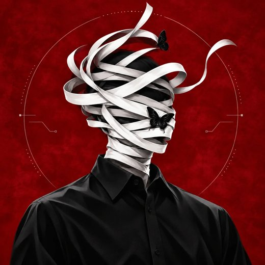

<!--
  ΛNKIT RΛTH — the profile as a film.
  Crimson key-art theme, matched to the portfolio: blood-red grunge,
  white silk ribbons, black letterbox, Michroma type, clapperboard slates.
  How to edit: see tools/README.md (graphics are generated by tools/gen.py).
-->

<div align="center">

<a href="https://portfolio-no8ankit.vercel.app/">
  
</a>


<br/>

<a href="https://portfolio-no8ankit.vercel.app/"></a>
<a href="https://www.linkedin.com/in/ankit-rath-678b57309"></a>
<a href="mailto:ankitrath58@gmail.com"></a>
<a href="https://github.com/Ankittian"></a>


</div>

<br/>





> *“How will you know when you're ready? You won't. It's just a leap of faith.”*

**Ankit Rath** — final-year B.Tech at **[IIT Bhilai](https://www.iitbhilai.ac.in/)** (Class of '27, CGPA 8.65), building high-precision AI systems: **3D Gaussian Splatting** pipelines, **Agentic RAG** workflows and **computer vision** that holds up outside the notebook.

```yaml
role:        AI Researcher & Developer
based_in:    IIT Bhilai, India
genre:       Computer Vision · Deep Learning · LLM Systems
now_filming: depth-conditioned 3D reconstruction
off_screen:  cricket · table tennis · gaming · singing
signal:      ankitrath58@gmail.com
```

<br clear="right"/>



| REEL | PRODUCTION | WHAT HAPPENED ON SET |
| :--: | :--- | :--- |
| **01** | **TCS Research** · CV & DL Intern<br/><sub>May '26 — Jul '26</sub> | Built background **inpainting** pipelines and a **depth-conditioned 3D Gaussian Splatting** framework for multiview reconstruction — cut single-view hallucinations by **10%**. |
| **02** | **[Clairvyn AI](https://www.clairvyn.com/)** · AI/ML Intern<br/><sub>Aug '25 — Dec '25</sub> | Designed a **rule-driven RAG workflow** that turns knowledge bases into CAD-ready floor plans, with **DXF export** wired end-to-end. |
| **03** | **IIT Bhilai** · B.Tech<br/><sub>2023 — 2027</sub> | Heavy focus on ML, DL & AI. CGPA **8.65 / 10**. |



<div align="center">
  
  <br/>
  
</div>

<details>
<summary><b>▸ FULL CREW LIST</b></summary>
<br/>

| DEPARTMENT | CREW |
| :--- | :--- |
| **Languages** | Python · C/C++ · JavaScript · SQL · MATLAB · CUDA · LaTeX |
| **ML / AI** | PyTorch · TensorFlow · LLMs (LLaMA · Gemini · OpenAI) · RAG · AI Agents · Prompt Engineering · LLM Evaluation · YOLO · OpenCV · NLP |
| **GenAI** | LangChain · LangGraph · LangSmith · HuggingFace · RAGAS · Agent Workflows |
| **Backend** | Node.js · Express.js · REST APIs · JWT Auth · WebSockets |
| **MLOps** | FastAPI · Docker · MLflow |
| **Databases** | MongoDB · PostgreSQL · MySQL · FAISS · Pinecone · Vector DBs |
| **Frontend** | HTML/CSS · Streamlit |
| **Data Science** | NumPy · Pandas · Matplotlib · Seaborn · Plotly · NLTK |
| **Tools** | Git · Linux · Postman · Jest · AWS (S3 · EC2) |

</details>



<table>
<tr>
<td width="50%" valign="top">
<a href="https://github.com/Ankittian/Medical-Assistant-Chatbot-app"></a>

<sub>FEATURE 01 · RATED **95% RETRIEVAL ACCURACY**</sub>
### [RAG-Powered Medical Assistant](https://github.com/Ankittian/Medical-Assistant-Chatbot-app)
A secure RAG chatbot over a curated clinical knowledge base — hallucination guardrails, unsafe-output filters, monitored and evaluated with **RAGAS + LangSmith**.

    
</td>
<td width="50%" valign="top">
<a href="https://github.com/Ankittian/Langraph_powered_AI_Trip_Planner"></a>

<sub>FEATURE 02 · NOW **STREAMING** (SSE)</sub>
### [LangGraph AI Trip Planner](https://github.com/Ankittian/Langraph_powered_AI_Trip_Planner)
A ReAct-style LangGraph agent that plans multi-day itineraries with live weather, place discovery, currency conversion and budget tools — Gemini/Groq switching and Markdown export.

    
</td>
</tr>
</table>



<div align="center">
  
  
  <br/><br/>
  
  <br/><br/>
  <picture>
    <source media="(prefers-color-scheme: dark)" srcset="https://raw.githubusercontent.com/Ankittian/Ankittian/output/snake-crimson-dark.svg">
    
  </picture>
</div>



| ROLE | PLAYED AS |
| :--- | :--- |
| 🎥 **Sports Media Head** | Leads sports media coverage at IIT Bhilai |
| 🧭 **SMP Student Mentor** | Guiding first-years through their opening act |
| 🤝 **OLF Foundation Mentor** | Teaching and mentoring beyond campus |
| 📈 **Fintech Club** | Founding member |



<div align="center">


**Open to collaborations in AI / CV.** The fastest way to reach me is email — I reply quickly.

<a href="mailto:ankitrath58@gmail.com"></a>
<a href="https://www.linkedin.com/in/ankit-rath-678b57309"></a>
<a href="https://portfolio-no8ankit.vercel.app/"></a>

<br/><br/>


</div>
